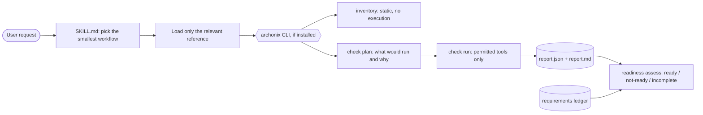

# Archonix

**From product understanding to production-ready software.**

Archonix is an open-source, model-agnostic software engineering skill system for AI
coding assistants. It gives an assistant structured workflows for understanding a product
or codebase, discovering requirements, designing and implementing changes, validating
behaviour, investigating risks and assessing release readiness, plus a small Python CLI
that produces the repeatable evidence those workflows rely on.

> Status: **v0.1, alpha.** Archonix does not make software secure or production-ready on
> its own. It helps an assistant (and you) work from evidence and report honestly about
> what was and was not verified. See [docs/capabilities.md](docs/capabilities.md) for
> exactly what is implemented and tested.

## What is in the box

| Part | Path | What it is |
|---|---|---|
| Skill entry point | [`skills/archonix/SKILL.md`](skills/archonix/SKILL.md) | Workflow selection and operating rules (Agent Skills format) |
| Workflow references | [`skills/archonix/references/`](skills/archonix/references/) | Discovery, implementation, bugs, review, testing, security, dead code, performance, release, architecture — loaded only when needed |
| Templates | [`skills/archonix/templates/`](skills/archonix/templates/) | Documents Archonix generates in *your* project (spec, journeys, ADRs, findings, …) |
| Schemas | [`skills/archonix/schemas/`](skills/archonix/schemas/) | Versioned JSON Schemas (v0.1) for requirements, config, inventory, executions, findings, reports, readiness, performance |
| CLI | [`src/archonix/`](src/archonix/) | Deterministic helpers: inventory, check planning/execution, report validation/rendering, readiness, diagrams, installer |
| Adapters | [`adapters/`](adapters/) | Thin install/usage notes for Claude Code, OpenAI Codex and Cursor |
| Examples | [`examples/`](examples/) | Synthetic repositories and example reports (clearly labelled) |

The skill content is the same for every assistant; adapters only document where each
assistant looks for skills.

## Quickstart

Requires Python 3.11+.

```bash
git clone https://github.com/ayushsaxenagithub/Archonix.git
cd Archonix
pip install .                      # or: uv tool install .   /   pipx install .

archonix --version
archonix inventory examples/python-service          # static: reads files, runs nothing
archonix check plan examples/python-service --mode audit
```

Run a real check-to-report flow (needs any of `ruff`, `bandit`, `vulture` on PATH;
`pip install ruff bandit vulture`):

```bash
archonix check run examples/python-service --mode audit --out-dir /tmp/archonix-demo
archonix validate /tmp/archonix-demo/report.json
less /tmp/archonix-demo/report.md
```

Install the skill for your assistant (dry run first, then `--apply`):

```bash
archonix install --assistant claude                 # ~/.claude/skills/archonix
archonix install --assistant claude --apply
archonix install --assistant codex --scope project --project-dir . --apply   # .agents/skills/archonix
```

Without the CLI you can copy `skills/archonix/` into the assistant's skills directory by
hand; see [docs/installation.md](docs/installation.md).

Then ask your assistant things like *"Use Archonix to understand this repository"*,
*"Discover requirements for a team invoicing feature"*, *"Fix this bug with Archonix"* or
*"Run an Archonix security audit"*.

## How it works



- **Evidence over assumptions.** Every execution is recorded with command, cwd, tool
  version, UTC start time, duration, exit status and its tool-specific meaning, counts and
  parsing limitations. Unknown counts stay `null`.
- **Safe defaults.** Discovery mode executes nothing and uses no network. Running external
  tools, repository code (tests) or network-backed scanners each needs its own permission.
  Repository config can only *restrict* permissions. See
  [docs/trust-model.md](docs/trust-model.md).
- **Honest results.** Tool findings are kept separate from tool failures; missing evidence
  makes a readiness verdict `incomplete`, never `ready`; a clean scan is never described as
  proof of security.

## Documentation

- [Installation](docs/installation.md) · [CLI reference](docs/cli.md) ·
  [Configuration](docs/configuration.md) · [Workflows](docs/workflows.md)
- [Permission and trust model](docs/trust-model.md) · [Tool adapters](docs/tool-adapters.md)
- [Assistant compatibility](docs/assistants.md) · [Capabilities and status](docs/capabilities.md)
- [Architecture](docs/architecture.md) · [Decision records](docs/architecture-decisions/)
- [Troubleshooting](docs/troubleshooting.md) · [Limitations and roadmap](docs/roadmap.md)
- [Contributing](CONTRIBUTING.md) · [Security policy](SECURITY.md) · [Agent instructions](AGENTS.md)

## License

[MIT](LICENSE).
