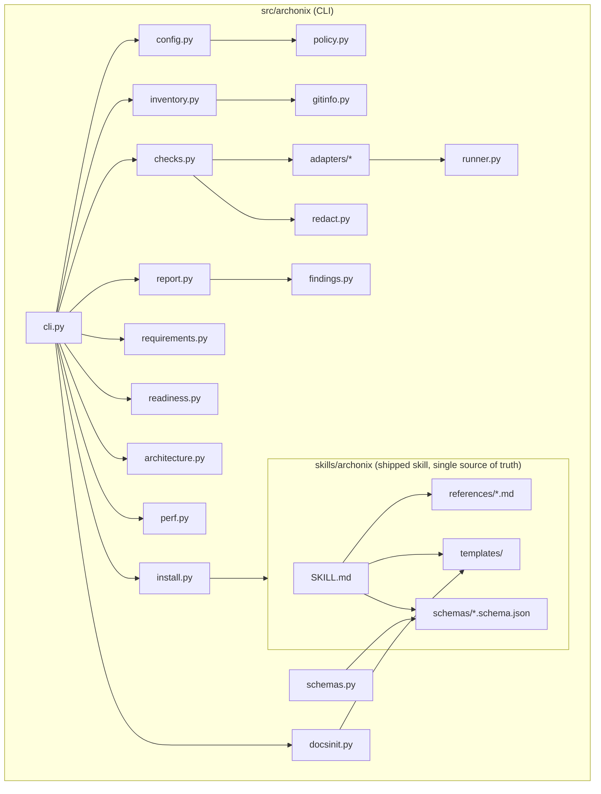

# Archonix architecture

## Shape

## Key flows

**Check-to-report.** `inventory.build_inventory` (static) → `checks.plan_checks` decides
`run`/`skip`/`block` per adapter from applicability, configuration, permissions and tool
availability → `checks.execute_plan` launches each permitted adapter through
`runner.run`, then `Adapter.interpret` maps exit code + output to an outcome and
normalized findings → redaction → `report.build_workflow_report` (dedup, summary,
limitations, next actions) → schema validation → JSON/Markdown.

**Readiness.** Workflow reports + optional ledger + policy → `readiness.assess` → rules
evaluated to pass/fail/unknown → verdict.

## Design choices

- **Skill content is shared** by all assistants; adapters are documentation, not forks
  ([ADR-0002](architecture-decisions/0002-single-skill-source.md)).
- **Standard library first.** argparse, tomllib, urllib, ast, xml.etree; only `jsonschema`
  is a runtime dependency ([ADR-0003](architecture-decisions/0003-minimal-dependencies.md)).
- **Maintained tools over custom analysis.** Adapters wrap ruff/bandit/vulture/etc.; the
  only custom analysis is manifest parsing and a Python import graph via `ast`.
- **Explicit permissions per check** rather than a single "safe mode"
  ([ADR-0004](architecture-decisions/0004-permission-model.md)).
- **Readiness is fail-closed on missing evidence**
  ([ADR-0005](architecture-decisions/0005-readiness-unknown-is-not-pass.md)).
- **Schemas versioned at 0.1** with a `kind` field for inference; findings and execution
  records are embedded in reports ([ADR-0001](architecture-decisions/0001-record-architecture-decisions.md)).

## Extending

- New check: add an `Adapter` subclass (see CONTRIBUTING.md).
- New stack detections: extend the tables in `inventory.py`.
- New template set: add files under `skills/archonix/templates/` and an entry in
  `docsinit.TEMPLATE_SETS`.
