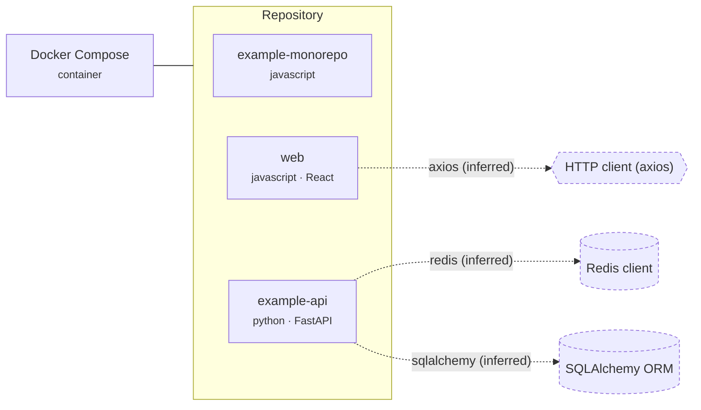

# System context (inventory-derived)

Legend: solid edges are verified from files; dashed edges are inferred from declared dependencies; items marked unknown could not be resolved statically.

## Evidence

| Element | Relationship | Status | Evidence |
|---|---|---|---|
| example-monorepo | project | verified | package.json |
| web | project | verified | apps/web/package.json |
| example-api | project | verified | services/api/pyproject.toml |
| apps/web -> HTTP client (axios) | uses | inferred | declared dependency 'axios' in apps/web/package.json |
| services/api -> Redis client | uses | inferred | declared dependency 'redis' in services/api/pyproject.toml |
| services/api -> SQLAlchemy ORM | uses | inferred | declared dependency 'sqlalchemy' in services/api/pyproject.toml |
| Docker Compose | container configuration | verified (file present) | docker-compose.yml |

## Limitations

- Static inspection of manifests and configuration files only; repository code was not imported or executed.
- Declared dependencies show intent, not runtime use; services configured outside the repository (environment variables, platform settings) are not visible.
