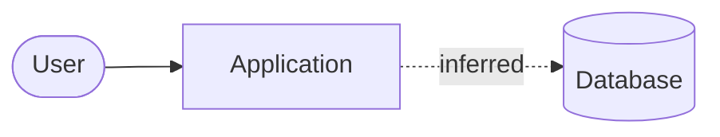
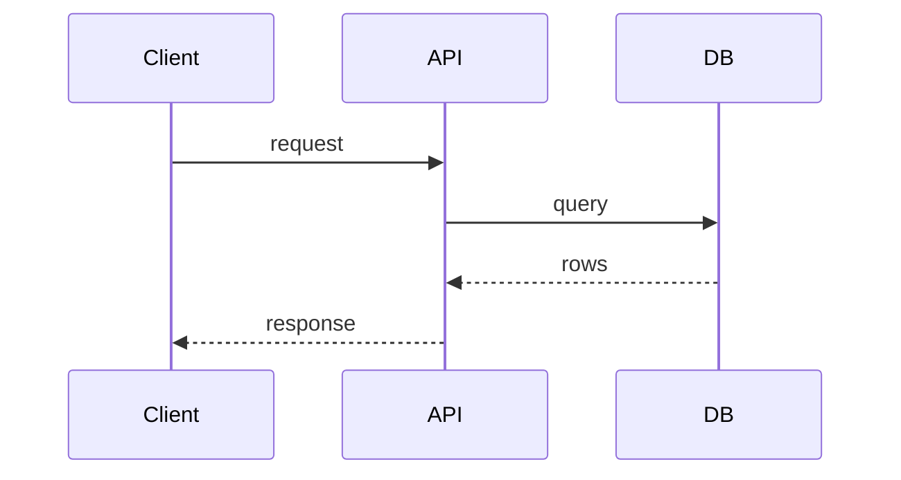

# {{project}} — Architecture

Last updated: {{date}}

Edge labels: **verified** (seen in code/config), **inferred** (implied by dependencies or
conventions), **unknown** (not determinable statically).

## System context

## Components
| Component | Responsibility | Path | Depends on | Evidence status |
|---|---|---|---|---|

## Request flow

## Authentication and authorization

## Background processing
<!-- Queues, retries, schedules, idempotency -->

## Deployment topology

## Evidence
| Element | Relationship | Status | Source |
|---|---|---|---|
