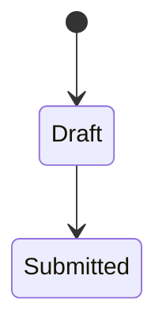

# {{project}} — Business rules

Last updated: {{date}}

| ID | Rule | Inputs | Outcome | Source | Requirement IDs |
|---|---|---|---|---|---|
| BR-001 | | | | user-confirmed / document / assumption | |

## Calculations
<!-- Formulas with units, rounding, currency and precision rules, worked examples -->

## Validations

## State transitions

